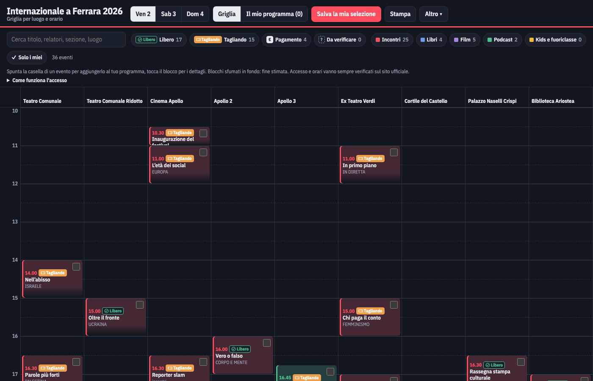

# Internazionale a Ferrara 2026: planner

Uno strumento statico per organizzare la visita al festival Internazionale a Ferrara: la griglia degli eventi per luogo e orario, i filtri per tipo di accesso (libero, con tagliando, a pagamento), il tuo programma personale da stampare o salvare sul telefono.



## Come aprirlo

Ci sono tre modi, scegli quello più comodo:

1. **Doppio clic su `index.html`**: si apre nel browser direttamente dal computer, senza installare nulla.
2. **Server locale**: dalla cartella del progetto esegui `python3 -m http.server` e apri <http://localhost:8000>.
3. **GitHub Pages**: una volta pubblicato (vedi sotto), basta aprire il link del sito, anche dal telefono.

## Come si usa

- Scegli il giorno in alto. Ogni blocco della griglia mostra orario, titolo, sezione e un'etichetta di accesso: **Libero**, **Tagliando**, **€** con il prezzo, **?** da verificare.
- Spunta la casella sul blocco per aggiungere l'evento al tuo programma. Tocca il blocco per i dettagli: descrizione, relatori, note sull'accesso, link alla pagina ufficiale ed eventi in parallelo.
- Filtra per accesso, per tipo di evento o con la ricerca: gli eventi esclusi restano visibili ma sbiaditi.
- Se sai che l'accesso di un evento è diverso da quello indicato, correggilo nella finestra di dettaglio: la modifica resta salvata nel browser ed è segnata come "modificato da te". Con "ripristina" torni al dato ufficiale.
- **Il mio programma** raccoglie gli eventi spuntati, giorno per giorno. Gli eventi che si sovrappongono sono raggruppati sotto "In parallelo", in cima trovi il riepilogo (tagliandi da ritirare, eventi a pagamento, costo noto) e per ogni giorno la lista dei tagliandi.
- **Salva la mia selezione** scarica un file HTML autonomo con il tuo programma: puoi aprirlo sul telefono anche senza connessione e stamparlo.
- **Stampa** produce un A4 in bianco e nero, un giorno per pagina, con una casella vuota accanto a ogni evento per segnare i tagliandi ritirati.
- Dal menu **Altro**: copia un link che contiene la tua selezione (chi lo apre può unirla alla propria o sostituirla), esporta e importa un backup JSON, esporta il calendario `.ics` da importare in Google Calendar, Apple Calendar o Outlook.

La selezione è salvata solo nel tuo browser (localStorage): nessun dato viene inviato altrove.

## Pubblicare su GitHub Pages

1. Crea un repository su GitHub e carica il contenuto di questa cartella nel branch `main`.
2. Vai in **Settings > Pages**.
3. In "Build and deployment" scegli **Deploy from a branch**, branch **main**, cartella **/ (root)**, e salva.
4. Dopo un paio di minuti il sito è raggiungibile all'indirizzo indicato nella stessa pagina.

Non serve nessun passaggio di build: sono solo file statici.

## Aggiornare i dati

I dati stanno in `data/programma-2026.json`. Dopo averlo modificato esegui:

```sh
python3 scripts/build-data.py
```

Lo script controlla il file (campi obbligatori, id unici, valori ammessi, giorni e orari validi), stampa un riepilogo e rigenera `data/programma-2026.js`, che è il file letto dalla pagina (così funziona anche aprendo `index.html` con un doppio clic). Se trova errori non scrive nulla e termina con un codice diverso da zero. Con `--check` fa solo la verifica.

Per una nuova edizione crea `data/programma-2027.json`, esegui `python3 scripts/build-data.py 2027` e cambia il nome del file nello `<script>` di `index.html`.

## Formato dei dati

```jsonc
{
  "festival": "Internazionale a Ferrara", "edition": 2026,
  "days": [{"date": "2026-10-02", "label": "Venerdì 2 ottobre"}],
  "venueOrder": ["Teatro Comunale"],          // ordine delle colonne nella griglia
  "venues": {"Teatro Comunale": {"address": "...", "defaultAccess": "pagamento"}},  // facoltativo
  "accessRules": "testo libero su come funziona l'accesso, con i link alle fonti",
  "events": [{
    "id": "10-02-1030-cinema-apollo",   // stabile: MM-DD-HHMM-luogo[-n]; non cambiarlo mai
    "day": "2026-10-02",                // una delle date in "days"
    "s": 630,                           // inizio, minuti dalla mezzanotte
    "d": 60,                            // durata in minuti
    "est": true,                        // true se durata o fine sono stimate
    "v": "Cinema Apollo",               // luogo
    "c": "EUROPA",                      // sezione come nel programma
    "t": "L'età dei social",            // titolo
    "x": "descrizione, crediti (a capo ammessi)",
    "speakers": "facoltativo, separati da virgola",
    "k": "talk|libri|film|audio|kids",
    "access": "gratuito|tagliando|pagamento|sconosciuto",
    "price": "€ 5",                     // oppure null
    "accessNote": "dove e quando ritirare il tagliando, ecc.",
    "src": "URL della pagina ufficiale, oppure ''"
  }],
  "meta": {"source": "...", "updated": "AAAA-MM-GG"}
}
```

Valori di `access`: `gratuito` (ingresso libero fino a esaurimento posti), `tagliando` (gratuito ma serve il tagliando ritirato prima), `pagamento` (biglietto), `sconosciuto` (non verificato, mostrato come "da verificare").

Gli `id` servono a ritrovare la selezione salvata e i link condivisi: se cambiano, le selezioni esistenti non li riconoscono più.

## Avvertenza sui dati

Il programma è stato ricostruito a partire dalle pagine pubbliche del festival e può contenere errori o non essere aggiornato: orari, luoghi, modalità di accesso e prezzi vanno sempre verificati sul [sito ufficiale di Internazionale a Ferrara](https://www.internazionale.it/festival). Questo strumento non è affiliato a Internazionale.
